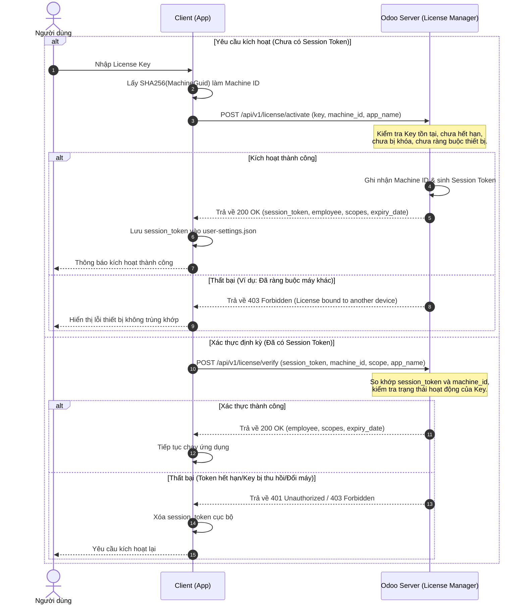

# Tài Liệu Đặc Tả Hệ Thống Xác Thực License Khóa Thiết Bị (Device-Lock)

Tài liệu này đặc tả hệ thống xác thực bản quyền phiên bản mới, hỗ trợ **khóa thiết bị dựa trên Machine ID (Hardware Guid)** và sử dụng **Session Token** để xác thực các lần truy cập tiếp theo.

---

## 1. Nguyên Lý Hoạt Động (Workflow)

Hệ thống hoạt động theo cơ chế **Kích hoạt 1 lần (Single Device Activation)**:
1. **Lần đầu sử dụng (Kích hoạt)**:
   - Người dùng nhập `License Key`.
   - Client lấy mã định danh phần cứng của máy (`Machine ID`) và gửi yêu cầu kích hoạt lên Odoo.
   - Odoo kiểm tra nếu Key chưa bị ràng buộc với thiết bị nào, hệ thống sẽ liên kết Key đó với `Machine ID` này và sinh ra một `Session Token` duy nhất.
2. **Các lần sử dụng tiếp theo (Xác thực)**:
   - Client sử dụng `Session Token` đã lưu cục bộ cùng với `Machine ID` để gửi yêu cầu xác thực.
   - Odoo đối chiếu `Session Token` và `Machine ID`. Nếu khớp và Key còn hạn/hoạt động, cho phép truy cập.
3. **Khi cần đổi máy (Reset)**:
   - Người quản trị trên Odoo có thể nhấp **Reset Key** hoặc xóa trường `Machine ID` trên bản ghi License để giải phóng Key, cho phép kích hoạt trên thiết bị mới.

### Biểu đồ luồng xác thực (Mermaid Diagram)



---

## 2. Cấu Trúc Bản Ghi Trên Odoo (Models)

Phân hệ `license_manager` cần lưu trữ thêm các thông tin phục vụ ràng buộc thiết bị trong model `license.key`:

*   **Mã thiết bị (`machine_id`)**: Chuỗi ký tự (Char) chứa mã băm phần cứng thiết bị kích hoạt đầu tiên.
*   **Mã phiên (`session_token`)**: Chuỗi ký tự (Char) sinh ngẫu nhiên kiểu UUID khi kích hoạt thành công.
*   **Lần cuối sử dụng (`last_used`)**: Thời gian gần nhất API xác thực thành công.

---

## 3. Chi Tiết API Xác Thực

### 3.1. API Kích hoạt License (Activation)

*   **URL**: `https://<domain-odoo>/api/v1/license/activate`
*   **Method**: `POST`
*   **Headers**:
    *   `Content-Type: application/json`
    *   `X-Odoo-Database: odoo_internal_local` (Bắt buộc nếu hệ thống multi-db)
*   **Request Body**:
```json
{
  "key": "LIC-E1B8-5E17-FEA7-4055",
  "machine_id": "4bff01922d320b79fdcf5568f1e573b08cd05bd5c7ed2f600cd12b0342cf4b4e",
  "app_name": "Post to Video Tool"
}
```

*   **Phản hồi thành công (`200 OK`)**:
```json
{
  "success": true,
  "message": "License activated successfully",
  "session_token": "869643045dd549c58cbb7b3de1b8f9f3",
  "employee": {
    "id": 1,
    "name": "Nguyen Van A",
    "email": "nva@company.com"
  },
  "scopes": ["threads", "admin"],
  "expiry_date": "2026-12-31"
}
```

*   **Các phản hồi lỗi thường gặp**:
    *   `400 Bad Request`: Thiếu tham số truyền lên.
        ```json
        {"success": false, "message": "License key and machine ID are required"}
        ```
    *   `404 Not Found`: Không tìm thấy Key trên hệ thống.
        ```json
        {"success": false, "message": "License key not found"}
        ```
    *   `403 Forbidden`: Key đã kích hoạt ở máy khác.
        ```json
        {"success": false, "message": "License has already been activated on another device"}
        ```
    *   `403 Forbidden`: Bản quyền đã hết hạn hoặc bị thu hồi (Revoked).
        ```json
        {"success": false, "message": "License has expired"} / {"success": false, "message": "License has been revoked"}
        ```

---

### 3.2. API Xác thực Phiên (Verification)

*   **URL**: `https://<domain-odoo>/api/v1/license/verify`
*   **Method**: `POST`
*   **Headers**:
    *   `Content-Type: application/json`
    *   `X-Odoo-Database: odoo_internal_local`
*   **Request Body**:
```json
{
  "session_token": "869643045dd549c58cbb7b3de1b8f9f3",
  "machine_id": "4bff01922d320b79fdcf5568f1e573b08cd05bd5c7ed2f600cd12b0342cf4b4e",
  "scope": "threads",
  "app_name": "Post to Video Tool"
}
```

*   **Phản hồi thành công (`200 OK`)**:
```json
{
  "success": true,
  "message": "License is active and valid",
  "employee": {
    "id": 1,
    "name": "Nguyen Van A",
    "email": "nva@company.com"
  },
  "scopes": ["threads", "admin"],
  "expiry_date": "2026-12-31"
}
```

*   **Các phản hồi lỗi**:
    *   `401 Unauthorized`: Token không hợp lệ hoặc đã bị reset.
        ```json
        {"success": false, "message": "Invalid session token"}
        ```
    *   `403 Forbidden`: Token hợp lệ nhưng gửi từ máy khác với máy đã kích hoạt.
        ```json
        {"success": false, "message": "License is activated on another device"}
        ```
    *   `403 Forbidden`: Key bị thiếu quyền (Scope) truy cập ứng dụng.
        ```json
        {"success": false, "message": "Required scope \"threads\" is not authorized for this license"}
        ```

---

## 4. Code Mẫu Tích Hợp (Client Examples)

### 4.1. Cách lấy Machine ID duy nhất (Node.js/Bun)
```typescript
import { execSync } from "node:child_process";
import { createHash } from "node:crypto";

export function getMachineId(): string {
  try {
    if (process.platform === "win32") {
      const output = execSync(
        'reg query "HKEY_LOCAL_MACHINE\\SOFTWARE\\Microsoft\\Cryptography" /v MachineGuid',
        { encoding: "utf8", stdio: ["ignore", "pipe", "ignore"] }
      );
      const match = /MachineGuid\s+REG_SZ\s+([a-zA-Z0-9-]+)/i.exec(output);
      if (match && match[1]) {
        return createHash("sha256").update(match[1].trim()).digest("hex");
      }
    }
  } catch (e) {
    // Fallback
  }
  return "fallback-machine-id";
}
```

### 4.2. Tích hợp Python (Client Desktop)
```python
import requests
import subprocess
import hashlib

def get_machine_id():
    try:
        # Lấy MachineGuid trên Windows
        output = subprocess.check_output(
            'reg query "HKEY_LOCAL_MACHINE\\SOFTWARE\\Microsoft\\Cryptography" /v MachineGuid',
            shell=True, stderr=subprocess.DEVNULL
        ).decode().strip()
        guid = output.split()[-1]
        return hashlib.sha256(guid.encode('utf-8')).hexdigest()
    except Exception:
        return "fallback-python-machine-id"

def activate_license(key, verify_url, db_name="odoo_internal_local"):
    activate_url = verify_url.replace("/verify", "/activate")
    payload = {
        "key": key,
        "machine_id": get_machine_id(),
        "app_name": "Post to Video Tool"
    }
    headers = {
        "Content-Type": "application/json",
        "X-Odoo-Database": db_name
    }
    r = requests.post(activate_url, json=payload, headers=headers)
    return r.json(), r.status_code

def verify_license(session_token, verify_url, scope="threads", db_name="odoo_internal_local"):
    payload = {
        "session_token": session_token,
        "machine_id": get_machine_id(),
        "scope": scope,
        "app_name": "Post to Video Tool"
    }
    headers = {
        "Content-Type": "application/json",
        "X-Odoo-Database": db_name
    }
    r = requests.post(verify_url, json=payload, headers=headers)
    return r.json(), r.status_code
```
